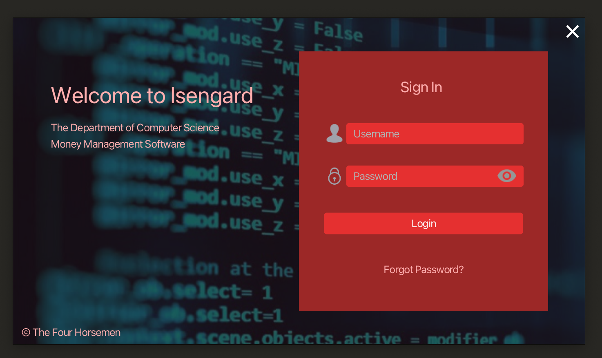
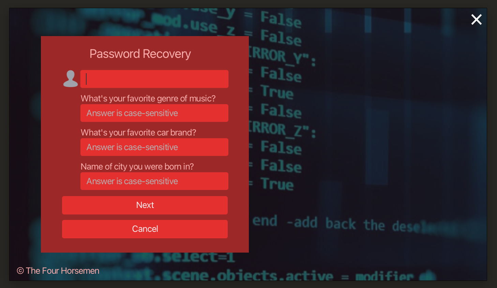
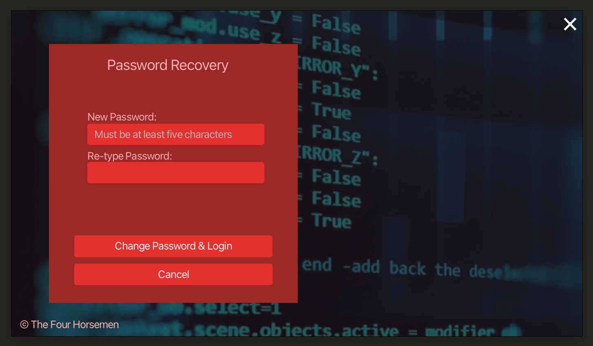
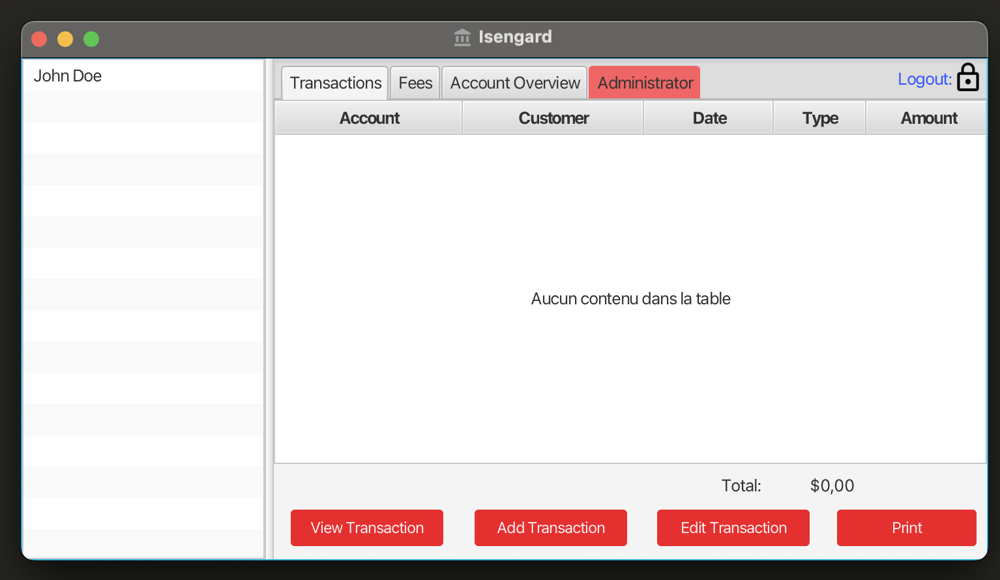
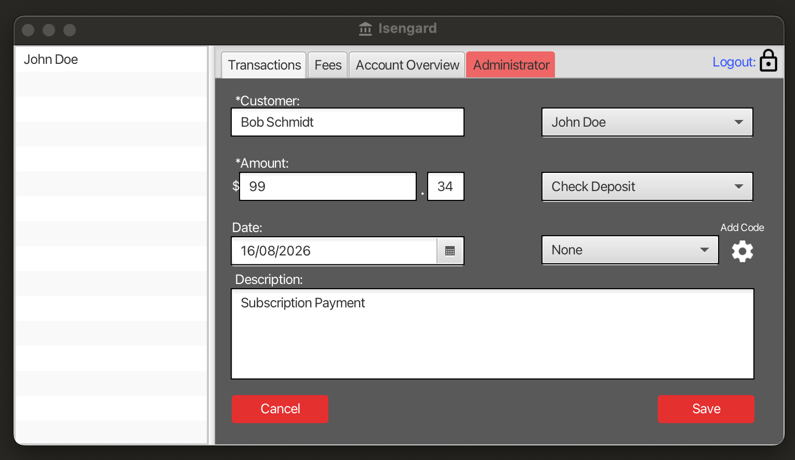
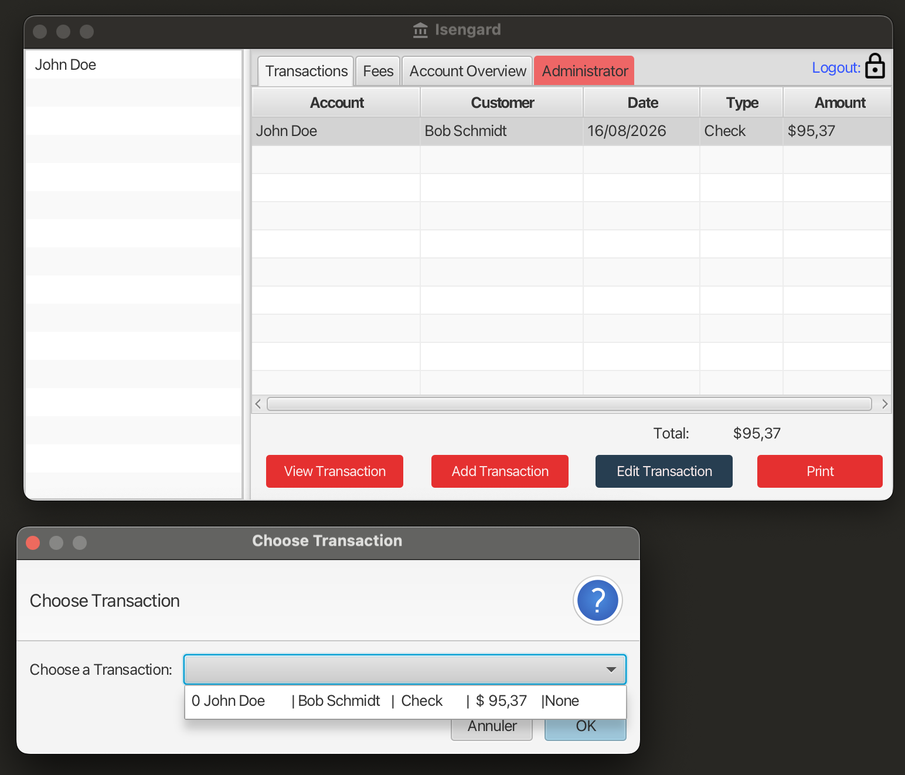
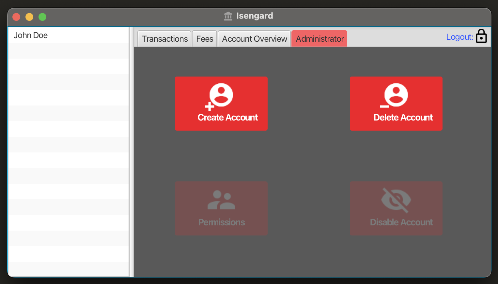

# Isengard

This is an old classroom capstone project for the University of Montana's Computer Science department. 

To run this software, you will need the following set-up on your system:

An [SDK manager](https://sdkman.io/), to install run: 
```bash
curl -s "https://get.sdkman.io" | bash
```
Then restart your terminal.

Install the correct Java version:
```bash
sdk install java 21.0.12.fx-librca
```

Once installed, run the `use` command to set it as the current SDK
```bash
sdk use java 21.0.12.fx-librca
```

Compile the program from `isengard_source_code/src/application`:
```bash
javac *.java controller/*.java -cp "../../Libraries/algs4.jar:../../Libraries/stdlib.jar"
```

Launch "The Four Horsemen" from `isengard_source_code/src`:
```bash
java -cp ".:../Libraries/algs4.jar:../Libraries/stdlib.jar" application.Main
```

To login enter the following credentials:
Username: `testuser`
Password: `12345`

## Images

| | |
|---|---|
|  Login |  Password recovery |
|  Reset password |  Transactions |
|  Add transaction |  Selecting a transaction |
|  Administrator panel | |
